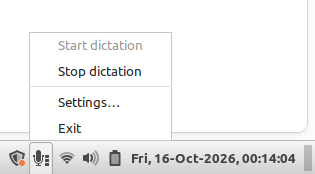

# nerd-dictation-tray

A system tray icon for [nerd-dictation](https://github.com/ideasman42/nerd-dictation),
the offline VOSK-based voice typing tool for Linux.



- **Right-click** the icon: Start dictation, Stop dictation, Settings…, Exit
- **Left-click** the icon: toggle dictation on/off
- The icon turns **green** while dictating, and a sound plays on start/stop
- **Global shortcuts** (default `Super+Alt+D` to start, `Super+Alt+S` to stop)

## Requirements

- Linux on **X11** (global shortcuts use Keybinder, which doesn't work on Wayland)
- System Python 3 with GTK 3 bindings, XApp and Keybinder (preinstalled on Linux Mint Cinnamon).
  On Debian/Ubuntu: `sudo apt install python3-gi gir1.2-gtk-3.0 gir1.2-xapp-1.0 gir1.2-keybinder-3.0`
- A Python that has `vosk` installed (the same one `nerd-dictation` uses)

## Usage

```sh
tray/nerd-dictation-tray   # run it
tray/install.sh            # add "Nerd Dictation" to the applications menu
```

The tray app uses the `nerd-dictation` script at the root of this repository
(falling back to your `PATH`). You can also set it in Settings.

## Settings

Stored in `~/.config/nerd-dictation/tray.json`:

| Setting | Description |
|---|---|
| Start / Stop shortcut | Click the button, press the keys. Esc cancels, Backspace clears. Using the same key for both makes it a toggle. |
| nerd-dictation | Path to the `nerd-dictation` script |
| Model folder | VOSK model to use (empty = `~/.config/nerd-dictation/model`) |
| Audio input | `parec`, `pw-cat` or `sox` |
| Noise suppression | Dictate through a WebRTC-filtered copy of the default mic ("Dictation Mic", PulseAudio `module-echo-cancel`) that removes background noise and breathing. Other apps keep the normal mic. `parec` input only. |
| Sounds | Play a sound when dictation is ready and when it has fully stopped; pick and preview the files |
| Start on login | Adds/removes `~/.config/autostart/nerd-dictation-tray.desktop` |
